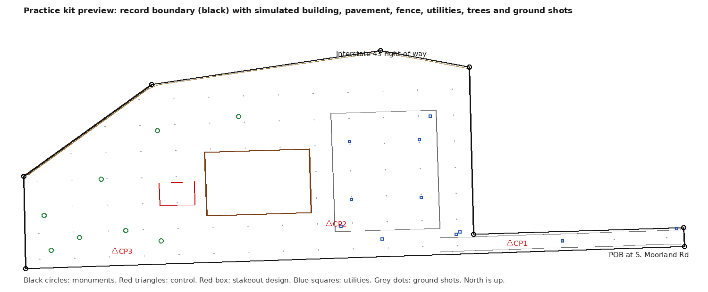

# Survey practice kit (roadmap item 57)

A practice ALTA/NSPS-style survey drawing of one real lot, to be drawn in the Autodesk Civil 3D free trial. This folder holds everything needed to start: the record boundary, a simulated field file, two hand-calculation exercises, a checklist and an answer key.

**This is a practice exercise, not a survey.** Only a licensed surveyor can produce an ALTA/NSPS Land Title Survey. The finished sheet's title block must say "Practice exercise, not a survey", and anything simulated must be labeled as simulated.



## The lot

| | |
|---|---|
| Location | West side of S. Moorland Road (C.T.H. "O"), south of Interstate 43, City of New Berlin, Waukesha County |
| Legal | Part of the NE 1/4 of the SE 1/4 of Section 27, Town 6 North, Range 20 East |
| Stated area | 247,672 sq ft (5.6858 acres) |
| Source | A certified survey map consolidating Lots 1 and 2 of CSM No. 12253, by Grady L. Gosser, PLS, Trio Engineering (Brookfield), as submitted to the City of New Berlin: <https://newberlinwi.gov/DocumentCenter/View/25708/MRM-CSM-2025-10-24> |

Things to know about the source:

- **It is a draft.** The copy is dated October 24, 2025, has no CSM number and is unsigned. The recorded map may differ. Before calling the drawing finished, get the recorded map from the Waukesha County Register of Deeds and compare every course.
- **Sheet 1 was not read.** The courses below come from the surveyor's certificate on sheets 2 and 3. The map sheet itself (monuments, easements, basis of bearings, adjoiners) still needs to be read from the PDF.
- **It is in New Berlin, next to Brookfield.** It was the nearest lot with a complete public description that could be read without paying for a recorded image. Swap in a Brookfield lot later if you prefer; only `build_kit.py`'s course list changes.
- **The courses check out.** They close to 0.01 ft (about 1 in 284,000) and give 247,675 sq ft against the stated 247,672.

### Record courses (`csm_courses.csv`)

Commencing at the southeast corner of the SE 1/4 of Section 27:

| | Bearing | Distance (ft) | Along |
|---|---|---|---|
| Tie 1 | N 00°53'38" W | 1327.45 | east line of the SE 1/4 |
| Tie 2 | S 88°05'29" W | 198.38 | south line of the NE 1/4 of the SE 1/4, to the west right-of-way of S. Moorland Road: the point of beginning |
| 1 | S 88°05'29" W | 1135.01 | south line of the NE 1/4 of the SE 1/4 |
| 2 | N 01°13'51" W | 158.57 | west line of the NE 1/4 of the SE 1/4, to the Interstate 43 right-of-way |
| 3 | N 54°14'19" E | 272.29 | Interstate 43 southerly right-of-way |
| 4 | N 81°36'30" E | 398.06 | Interstate 43 southerly right-of-way |
| 5 | S 79°24'35" E | 155.82 | Interstate 43 southerly right-of-way |
| 6 | S 01°21'38" E | 288.47 | |
| 7 | N 88°05'29" E | 362.08 | to the west right-of-way of S. Moorland Road |
| 8 | S 01°59'46" E | 33.00 | S. Moorland Road right-of-way, to the point of beginning |

## What is real and what is simulated

| Real (from the public record) | Simulated (invented for practice) |
|---|---|
| The two tie courses and eight boundary courses | The coordinates: an assumed grid with the point of beginning at N 5000.00, E 6500.00 |
| The stated area, section, town and range | Every field shot: found monuments, building, pavement, fence, utilities, trees, ground shots |
| The road and highway names | All elevations (assumed datum, benchmark BM1 = 860.00) |
| | The levelling loop and the stakeout design |

The real property has its own buildings and features. None of them are in this kit, so the finished drawing will not look like the actual site, and it must not be presented as if it does.

## The six steps and their files

| Step | What you do | File | Posting duty it covers |
|---|---|---|---|
| 1 | Open the source PDF, find sheet 1 and read the map against the courses above | source link | Read and interpret survey maps and plats |
| 2 | Enter the boundary by bearings and distances, check closure and area | `csm_courses.csv` | Survey calculations; Civil 3D |
| 3 | Import the field shots, draw the linework, build a surface with contours | `field_shots_PNEZD.csv` | Downloading, organizing and reviewing field data; topographic surveys |
| 4 | Write a page of field notes with a sketch, and reduce the levelling loop by hand | `level_loop.csv` | Field notes and sketches; benchmarks and control |
| 5 | Lay out the sheet and go through the checklist | `ALTA_CHECKLIST.md` | ALTA/NSPS surveys |
| 6 | Compute the stakeout angles and distances by hand, then check them in Civil 3D | `stakeout_design.csv` | Construction staking |

`ANSWER_KEY.md` has the results for steps 2, 4 and 6, plus a found-versus-record monument table. Try each step before opening it.

### The field file

`field_shots_PNEZD.csv` has 149 points, comma-separated, no header row, in the order **point number, northing, easting, elevation, description** (Civil 3D's PNEZD format).

| Points | Description codes | What they are |
|---|---|---|
| 1–3 | `CP1`–`CP3` | Control points |
| 4 | `BM1 TOP NUT HYD` | Benchmark, elevation 860.00 |
| 101–108 | `IPF 1IN`, `IRF 3/4 REBAR`, `IRS 3/4 REBAR SET` | Monuments at the eight corners, starting at the point of beginning. Found ones sit a few hundredths off the record position |
| 201–204 | `BLDG1` | Building corners |
| 301–304 | `EP1` | Parking lot edge of pavement |
| 311–326 | `EP2`, `EP3` | The two edges of the access drive |
| 401–411 | `SIGN`, `HYD`, `WV`, `SSMH RIM`, `CB RIM`, `LP` | Sign, hydrant, water valve, sanitary manholes, catch basins, light poles |
| 501–509 | `FNC1` | Fence along the Interstate 43 line |
| 601–608 | `TREE 12IN` and similar | Trees with trunk diameter |
| 1001 and up | `GND` | Ground shots for the surface |

Line codes follow the description: `B` begins a line, `E` ends it and `CLS` closes it back to its start (for example `EP1 B`, `EP1`, `EP1`, `EP1 CLS`). These match Civil 3D's usual linework codes, but the walkthrough will confirm them against the exact version installed.

### Field notes (step 4)

Use one page of a field book or grid paper:

- **Left page:** the levelling loop from `level_loop.csv` as a table with columns for station, backsight, height of instrument, foresight and elevation. Reduce it by hand, do the arithmetic check, state the misclosure and adjust.
- **Right page:** a sketch of the site, not to scale, with a north arrow, the benchmark, the turning points, the building and the date, crew and weather lines filled in as a real page would be. Write "simulated readings" at the top.

## Next step

Install the Civil 3D trial (30 days from download, so start it with a free weekend ahead), then run this in PowerShell and report the output, so the step-by-step walkthrough is written for that exact version:

```powershell
Get-ItemProperty HKLM:\Software\Microsoft\Windows\CurrentVersion\Uninstall\* | Where-Object DisplayName -like "*Civil 3D*" | Select-Object DisplayName, DisplayVersion
```

## Rebuilding the kit

`python build_kit.py` rewrites the CSV files and the answer key (the simulated values use a fixed seed, so they do not change). `python make_preview.py` redraws `preview.png`.
